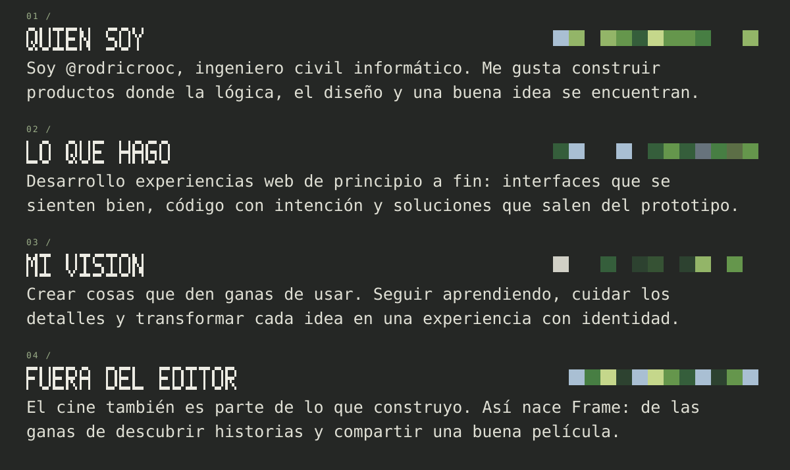
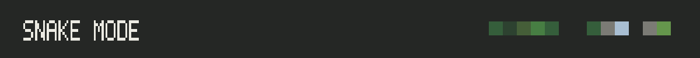
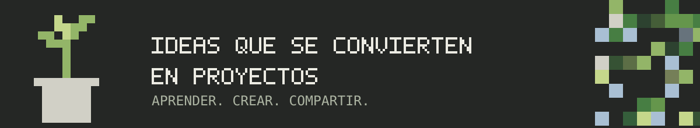

<!-- @rodricrooc · Diseño original de píxeles verdes. Las estadísticas se generan a partir de contribuciones reales. -->
<picture>
  <source media="(max-width: 600px)" srcset="./banner-mobile.svg" />
  
</picture>

<picture>
  <source media="(max-width: 600px)" srcset="./about-mobile.svg" />
  
</picture>

<picture>
  <source media="(max-width: 600px)" srcset="./activity-mobile.svg" />
  
</picture>

<samp>Cada contribución cuenta.</samp>

<picture>
  <source media="(max-width: 600px)" srcset="./stack-mobile.svg" />
  
</picture>

<samp>Interfaces · Aplicaciones web · Herramientas de desarrollo</samp>

<samp>HTML · CSS · JavaScript · TypeScript · React · Next.js</samp>

<samp>Tailwind CSS · Node.js · Vite · Cloudflare · Git · GitHub</samp>

<picture>
  <source media="(max-width: 600px)" srcset="./projects-mobile.svg" />
  
</picture>

### [Este perfil, por dentro](https://github.com/rodricrooc/rodricrooc)

<samp>Identidad visual retro, ilustraciones originales en SVG, variantes para celular y gráficos de contribuciones que se actualizan automáticamente.</samp>

[Explorar el código](https://github.com/rodricrooc/rodricrooc) · [Ver todos mis repositorios públicos](https://github.com/rodricrooc?tab=repositories)

<picture>
  <source media="(max-width: 600px)" srcset="./library-mobile.svg" />
  
</picture>

<samp>Recursos abiertos para seguir construyendo.</samp>

  
  
  

[Pro Git](https://git-scm.com/book/es/v2) · [TypeScript Handbook](https://www.typescriptlang.org/docs/handbook/intro.html) · [Learn React](https://react.dev/learn)

<picture>
  <source media="(max-width: 600px)" srcset="./snake-heading-mobile.svg" />
  
</picture>

<picture>
  <source media="(prefers-color-scheme: dark)" srcset="./dist/github-snake-dark.svg" />
  <source media="(prefers-color-scheme: light)" srcset="./dist/github-snake.svg" />
  
</picture>

<picture>
  <source media="(max-width: 600px)" srcset="./connect-mobile.svg" />
  
</picture>

<picture>
  <source media="(max-width: 600px)" srcset="./connect-art-mobile.svg" />
  
</picture>

<samp>¿Una idea, una pregunta o algo que construir?</samp>

<picture>
  <source media="(max-width: 600px)" srcset="./footer-mobile.svg" />
  
</picture>

Créditos y recursos

Ilustraciones y diseño de este perfil creados para @rodricrooc. Iconos: [Skill Icons](https://skillicons.dev). Insignias: [Shields.io](https://shields.io). Calendario 3D: [github-profile-3d-contrib](https://github.com/yoshi389111/github-profile-3d-contrib). Animación: [snk](https://github.com/Platane/snk).

