<!-- Green Editorial · Generado por build-profile.mjs. Editar esta fuente. -->
<picture>
  <source media="(max-width: 767px)" srcset="./banner-mobile.svg" />
  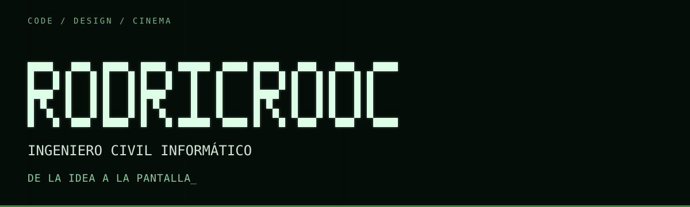
</picture>

<picture>
  <source media="(max-width: 767px)" srcset="./about-heading-mobile.svg" />
  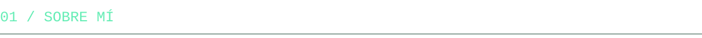
</picture>

Soy **@rodricrooc**, ingeniero civil informático. Desarrollo experiencias web donde el código, el diseño y la experiencia de uso trabajan juntos.

Me gusta convertir ideas en productos con identidad. **Frame** une dos de mis intereses: tecnología y cine.

<picture>
  <source media="(max-width: 767px)" srcset="./projects-mobile.svg" />
  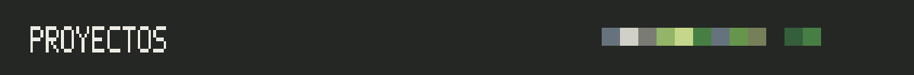
</picture>

<a href="https://frame.sotos.workers.dev/">
<picture>
  <source media="(max-width: 767px)" srcset="./frame-project-mobile.svg" />
  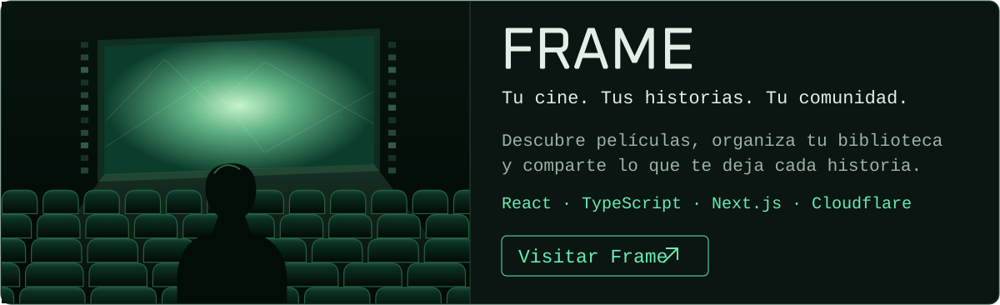
</picture>
</a>

<picture>
  <source media="(max-width: 767px)" srcset="./stack-heading-mobile.svg" />
  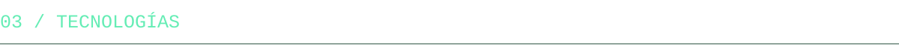
</picture>

<picture>
  <source media="(max-width: 767px)" srcset="./stack-mobile.svg" />
  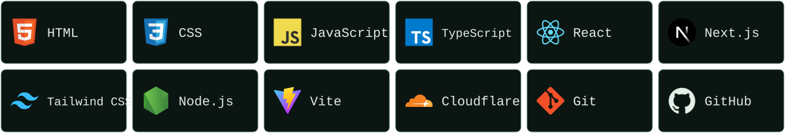
</picture>

<picture>
  <source media="(max-width: 767px)" srcset="./connect-mobile.svg" />
  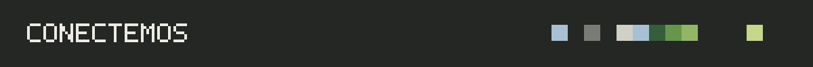
</picture>

<a href="mailto:rodri.crooc@gmail.com">
<picture>
  <source media="(max-width: 767px)" srcset="./social-email-mobile.svg" />
  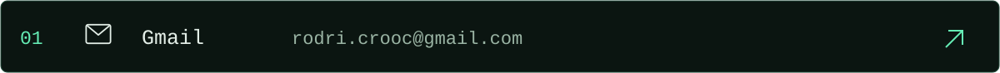
</picture>
</a>

<a href="https://frame.sotos.workers.dev/">
<picture>
  <source media="(max-width: 767px)" srcset="./social-frame-mobile.svg" />
  
</picture>
</a>

<a href="https://github.com/rodricrooc?tab=repositories">
<picture>
  <source media="(max-width: 767px)" srcset="./social-github-mobile.svg" />
  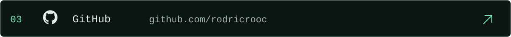
</picture>
</a>

<picture>
  <source media="(max-width: 767px)" srcset="./activity-mobile.svg" />
  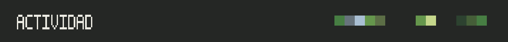
</picture>

<samp>Contribuciones reales · actualización diaria</samp>

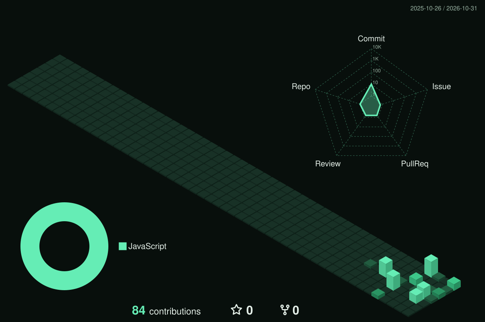

Abrir el calendario en tamaño completo

[Ver calendario 3D](./profile-3d-contrib/profile-night-green.svg)

<samp>Snake mode</samp>

<picture>
  <source media="(prefers-color-scheme: dark)" srcset="./dist/github-snake-dark.svg" />
  
</picture>

<picture>
  <source media="(max-width: 767px)" srcset="./library-mobile.svg" />
  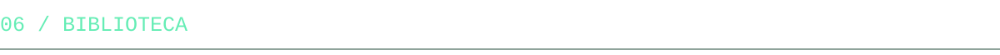
</picture>

<a href="https://git-scm.com/book/es/v2">
<picture>
  <source media="(max-width: 767px)" srcset="./book-git-mobile.svg" />
  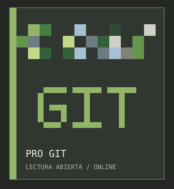
</picture>
</a>

<a href="https://www.typescriptlang.org/docs/handbook/intro.html">
<picture>
  <source media="(max-width: 767px)" srcset="./book-typescript-mobile.svg" />
  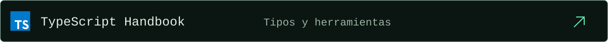
</picture>
</a>

<a href="https://react.dev/learn">
<picture>
  <source media="(max-width: 767px)" srcset="./book-react-mobile.svg" />
  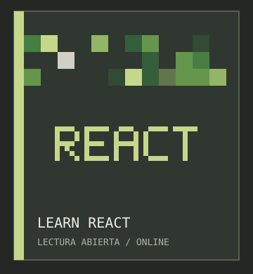
</picture>
</a>

<picture>
  <source media="(max-width: 767px)" srcset="./footer-mobile.svg" />
  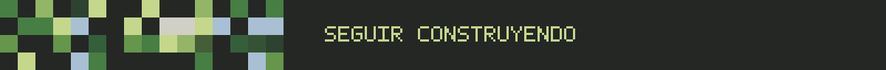
</picture>

Créditos y recursos

Diseño Green Editorial con portadas originales creadas para este perfil. Variantes para escritorio y móvil; la cabecera respeta la preferencia de movimiento reducido.

Tipografía: [Bodoni Moda](https://github.com/google/fonts/tree/main/ofl/bodonimoda), versiones romana e itálica, bajo [SIL Open Font License 1.1](https://github.com/google/fonts/blob/main/ofl/bodonimoda/OFL.txt). Los títulos se dibujan con vectores para conservar su aspecto en todos los dispositivos.

Iconos: [Devicon](https://github.com/devicons/devicon). Calendario: [github-profile-3d-contrib](https://github.com/yoshi389111/github-profile-3d-contrib). Animación de contribuciones: [snk](https://github.com/Platane/snk).

[Ver el código del perfil](https://github.com/rodricrooc/rodricrooc)

